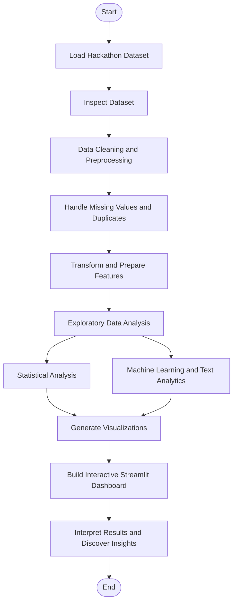
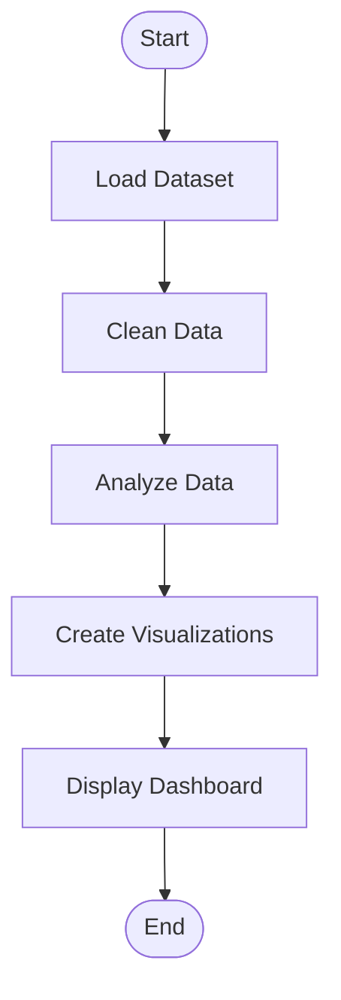
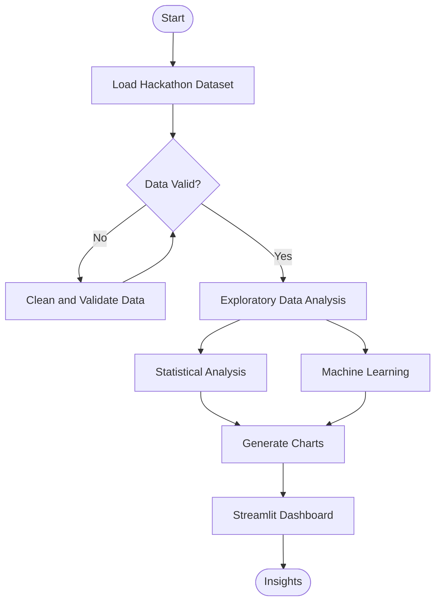
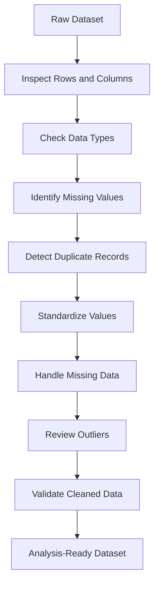
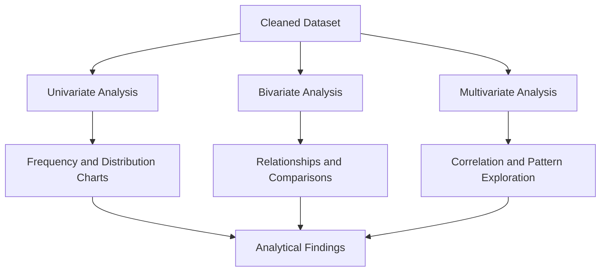
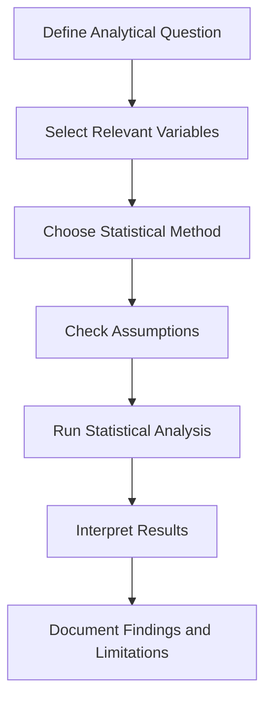
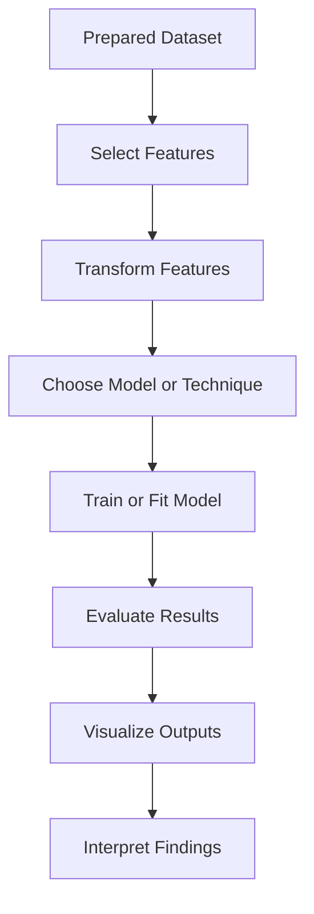
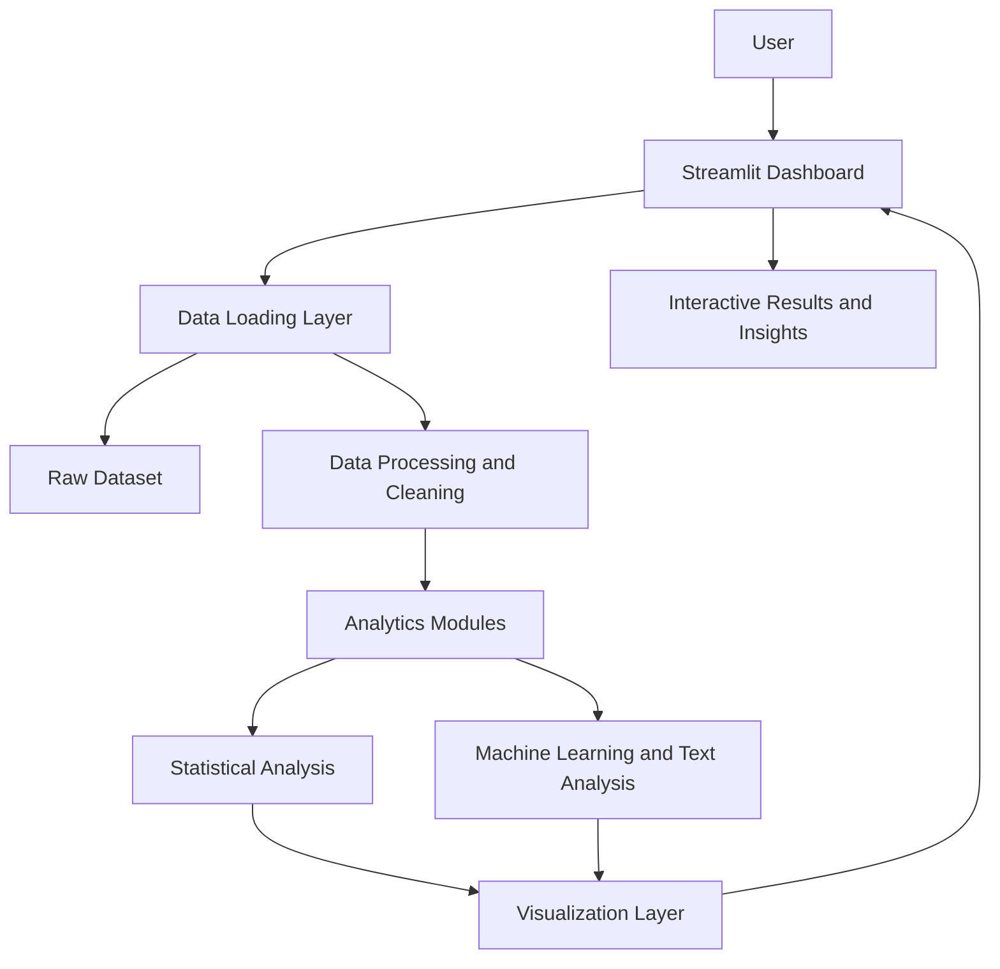

# Hackathon Insights 📊

🔗 **Live Dashboard:** [https://hackathon-insights.streamlit.app/](https://hackathon-insights.streamlit.app/)

*From Hackathon Problem Statements to Data-Driven Insights 🚀*

Hackathon Insights is a data analytics project designed to analyze hackathon problem statements, explore trends, understand domain distributions, and discover meaningful patterns through data cleaning, exploratory data analysis, statistical analysis, machine learning, and interactive visualizations.

---

## 📑 Table of Contents

1. [Project Overview](#-project-overview)
2. [Project Objectives](#-project-objectives)
3. [Project Workflow](#-project-workflow)
4. [Mermaid Flowchart Test](#-mermaid-flowchart-test)
5. [Data Cleaning Process](#-data-cleaning-process)
6. [Exploratory Data Analysis](#-exploratory-data-analysis)
7. [Statistical Analysis](#-statistical-analysis)
8. [Machine Learning and Text Analytics](#-machine-learning-and-text-analytics)
9. [System Architecture](#-system-architecture)
10. [Technology Stack](#-technology-stack)
11. [Getting Started](#-getting-started)
12. [Project Structure](#-project-structure)
13. [Testing and Verification](#-testing-and-verification)
14. [Deployment](#️-deployment)
15. [Limitations](#️-limitations)
16. [Future Enhancements](#-future-enhancements)
17. [Author](#-author)

---

## 🚀 Project Overview

Hackathon Insights transforms raw hackathon problem-statement data into meaningful analytical insights using Python and data analytics techniques.

The project demonstrates the complete data analytics lifecycle, from collecting and preparing data to analyzing patterns and presenting results through an interactive dashboard.

**Live Application:** [Open Hackathon Insights](https://hackathon-insights.streamlit.app/)

## 🎯 Project Objectives

- Analyze hackathon problem statements using data analytics.
- Clean and preprocess raw datasets.
- Explore distributions, patterns, and relationships in the data.
- Apply statistical techniques to investigate selected hypotheses.
- Explore machine learning and text analytics methods.
- Present analytical results through interactive charts and dashboards.
- Make the analysis accessible through a publicly deployed web application.

---

## 🔄 Project Workflow

The following flowchart illustrates the complete project process, from loading the dataset to presenting insights.



### Workflow Explanation

| Stage | Description |
|---|---|
| Data Loading | Load the available hackathon problem-statement dataset. |
| Data Inspection | Examine rows, columns, data types, and data quality. |
| Data Cleaning | Handle missing values, duplicates, and inconsistent values. |
| Feature Preparation | Prepare relevant features for analysis. |
| Exploratory Analysis | Explore patterns and distributions using charts. |
| Statistical Analysis | Apply suitable statistical methods. |
| Machine Learning | Explore predictive or unsupervised methods where implemented. |
| Visualization | Present findings through charts and graphs. |
| Dashboard | Provide an interactive interface for exploring results. |

---

## 🧪 Mermaid Flowchart Test

These two simple flowcharts can help verify that Mermaid diagrams render correctly on GitHub.

### Test 1 — Basic Flowchart



### Test 2 — Decision-Based Analytics Flowchart



**Expected result:** GitHub displays each flowchart as a visual diagram instead of showing the raw Mermaid code. Ensure each diagram is enclosed in a code block beginning with ` ```mermaid ` and ending with three backticks.

---

## 🧹 Data Cleaning Process

Data cleaning prepares raw data for analysis by identifying missing values, duplicate records, inconsistent categories, and unsuitable data types.



### Data Cleaning Activities

- Inspect the dataset dimensions and schema.
- Identify missing values in relevant columns.
- Detect and remove duplicate records where appropriate.
- Standardize text values and categorical labels.
- Handle missing data using suitable methods.
- Review numerical outliers.
- Validate the cleaned dataset before analysis.

*The exact cleaning operations depend on the implementation and the dataset.*

---

## 📈 Exploratory Data Analysis (EDA)

Exploratory Data Analysis helps uncover patterns and understand the characteristics of the dataset before drawing conclusions.

### Types of Visualizations

| Visualization | Purpose |
|---|---|
| Bar Chart | Compare problem-statement counts across categories. |
| Pie Chart | Understand proportions across a limited number of categories. |
| Histogram | Examine the distribution of numerical features. |
| Line Chart | Explore trends when meaningful time-based data is available. |
| Correlation Heatmap | Investigate relationships between numerical features. |
| Scatter Plot | Explore relationships between two variables. |
| Box Plot | Examine distributions and potential outliers. |

### EDA Workflow



---

## 📊 Statistical Analysis

Statistical analysis helps investigate relationships and test hypotheses using appropriate methods.

Potential methods include:

- **Descriptive Statistics:** Summarize numerical and categorical variables.
- **Correlation Analysis:** Investigate relationships between numerical variables.
- **T-tests:** Compare two groups when assumptions are satisfied.
- **ANOVA:** Compare group means when appropriate.
- **Chi-square Tests:** Investigate associations between categorical variables.
- **Regression Analysis:** Model numerical outcomes, if implemented.

### Statistical Analysis Workflow



Statistical significance does not establish causation. Conclusions should consider data quality, sample size, assumptions, and dataset composition.

---

## 🤖 Machine Learning and Text Analytics

Machine learning and text analytics can help explore similarities, patterns, and relationships in hackathon problem statements.

Potential techniques include:

- **Regression:** Estimate numerical outcomes from selected features.
- **Classification:** Predict a categorical target when suitable labels are available.
- **K-Means Clustering:** Explore groups of records based on selected features.
- **Principal Component Analysis (PCA):** Reduce dimensionality for exploratory analysis.
- **TF-IDF:** Represent text based on word importance.
- **Text Similarity:** Compare problem statements based on their textual content.

### Machine Learning Workflow



The techniques available in the deployed application depend on the methods implemented in the source code. Model performance should be reported only after running an appropriate evaluation.

---

## 🏗️ System Architecture

The following diagram illustrates the high-level architecture of the analytics application.



### Architecture Components

| Component | Responsibility |
|---|---|
| Streamlit Interface | Displays the dashboard and interactive controls. |
| Data Layer | Loads the available datasets. |
| Cleaning Layer | Prepares and validates data. |
| Analytics Layer | Performs supported statistical and machine learning operations. |
| Visualization Layer | Generates charts and graphical outputs. |
| Results Interface | Presents findings to the user. |

---

## 🛠️ Technology Stack

| Technology | Purpose |
|---|---|
| Python | Core programming language |
| Streamlit | Interactive dashboard |
| Pandas | Data manipulation and cleaning |
| NumPy | Numerical computations |
| Plotly | Interactive visualizations, if used |
| SciPy / Statsmodels | Statistical analysis, if used |
| Scikit-learn | Machine learning, if used |
| Git and GitHub | Version control and source code hosting |
| Streamlit Community Cloud | Public application deployment |

---

## 🏁 Getting Started

### Prerequisites

- Python installed.
- Git installed.
- VS Code or another code editor.

### 1. Clone the Repository

```bash
git clone https://github.com/YOUR-USERNAME/hackathon-insights.git
cd hackathon-insights
```

Replace `YOUR-USERNAME` with your actual GitHub username.

### 2. Create a Virtual Environment

```powershell
python -m venv .venv
```

### 3. Activate the Environment

```powershell
.\.venv\Scripts\Activate.ps1
```

### 4. Install Dependencies

```bash
python -m pip install --upgrade pip
pip install -r requirements.txt
```

### 5. Run the Application

```bash
python -m streamlit run app.py
```

Open the local URL shown in the terminal, usually:

`http://localhost:8501`

---

## 📂 Project Structure

```text
hackathon-insights/
│
├── app.py
├── pages/
│   └── Additional dashboard pages
│
├── src/
│   └── Analytics and data-processing modules
│
├── data/
│   └── Project datasets
│
├── scripts/
│   └── Data preparation and utility scripts
│
├── tests/
│   └── Automated tests
│
├── .streamlit/
│   └── Streamlit configuration
│
├── requirements.txt
├── .gitignore
└── README.md
```

*This is a high-level representation. Actual filenames and subfolders may differ.*

---

## 🧪 Testing and Verification

Run the automated tests from the project root:

```bash
python -m pytest
```

Launch the application locally:

```bash
python -m streamlit run app.py
```

### Verification Checklist

- [ ] Application starts successfully.
- [ ] Dataset loads correctly.
- [ ] Data cleaning executes without errors.
- [ ] Dashboard pages load.
- [ ] Charts render correctly.
- [ ] Statistical methods return valid results for appropriate inputs.
- [ ] Machine learning methods, if implemented, can be evaluated.
- [ ] Public deployment is accessible.

---

## ☁️ Deployment

The application is deployed through Streamlit Community Cloud.

🔗 **Public Dashboard:** [https://hackathon-insights.streamlit.app/](https://hackathon-insights.streamlit.app/)

### Updating the Project

After modifying the source code or README, run:

```bash
git add .
git commit -m "Update Hackathon Insights"
git push origin main
```

When the deployment is connected to the same GitHub repository and branch, new commits normally trigger redeployment.

---

## ⚠️ Limitations

- The analysis is limited by the coverage and quality of the available dataset.
- Synthetic records, if included, must be distinguished from real-world observations.
- Missing-value treatment and outlier handling can affect analytical results.
- Correlation does not imply causation.
- Statistical methods require suitable assumptions.
- Machine learning results depend on feature selection and evaluation methodology.
- Textual similarity does not necessarily mean that two problem statements are equivalent.

---

## 🗺️ Future Enhancements

- Expand the dataset with additional verified public records.
- Add data provenance and source references.
- Improve interactive filters and chart customization.
- Add export options for charts and analytical reports.
- Include documented model evaluation metrics.
- Add more automated tests for data cleaning and analytics.
- Improve reproducibility of experiments and reports.

---

## 👩‍💻 Author

**Bhavya Sri**

- **GitHub:** [pothireddybhavyasri](https://github.com/pothireddybhavyasri)
- **LinkedIn:** [Bhavya Sri](https://www.linkedin.com/in/pothireddy-bhavya-sri-031193328/)
- **Live Project:** [Hackathon Insights](https://hackathon-insights.streamlit.app/)

---

<p align="center">
  <strong>Hackathon Insights</strong><br>
  Turning problem-statement data into meaningful analytical insights 📊
</p>

